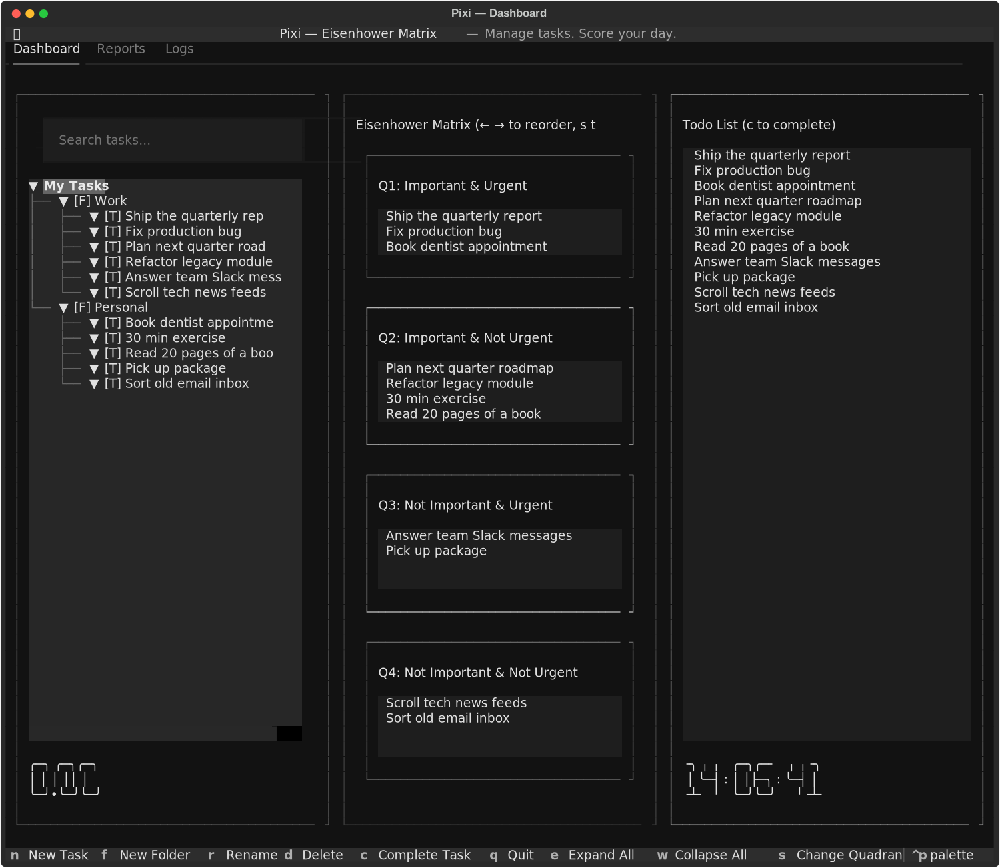

<div align="center">

# ⬛ Pixi

### A keyboard-driven Eisenhower Matrix task manager for your terminal

*Manage tasks. Prioritize ruthlessly. Score your day.*

[](https://github.com/BitEngineX/pixi/actions)
[](https://www.python.org/)
[](https://textual.textualize.io/)
[](LICENSE)
[](docs/tutorial-fa.md)

**English** | [🌊 فارسی](docs/tutorial-fa.md)

</div>

---

<div align="center">

</div>

## ✨ Why Pixi?

Most to-do apps ask *"what do you need to do?"* — Pixi asks *"what matters?"*

Pixi implements the **Eisenhower Matrix** as a fast, keyboard-driven terminal app: every task is triaged into one of four quadrants by **Importance × Urgency**, and a built-in **gamified scoring system** pressures you to do what actually matters — and *punishes* you for wasting the day. It ships as both an **interactive TUI** (built with [Textual](https://textual.textualize.io/)) for daily driving and a **scriptable CLI** for quick capture and automation.

## 🚀 Features

- 🌳 **Nested task tree** — folders and tasks, with live fuzzy search
- 🎯 **Eisenhower Matrix view** — drag tasks across Q1–Q4 with a single keypress, reorder priorities with `←`/`→`
- 📋 **Prioritized todo list** — auto-sorted across all quadrants, one place to work from
- ⭐ **Gamified daily scoring** — rewards for Q1/Q2, zero for busywork, *negative* points for Q4 slacking
- 🌙 **Automatic day rollover** — scores are archived to a report log at midnight; every day starts fresh at 0
- 💻 **Dual interface** — full TUI dashboard **plus** a scriptable CLI (`add`, `list`, `move`, `complete`, `stats`, …)
- 🗂️ **Reports & activity logs** — daily score history and a 500-entry activity trail
- 📦 **Zero-config data** — plain JSON files next to the code (or anywhere via `PIXI_DATA_DIR`)

## 🧠 The Scoring System

Pixi isn't just a checklist — it's a *behavior engine*. Each quadrant has a base score (**NQ**), and completing a task asks for a `value` (how big/valuable the task was):

| Quadrant | Meaning | Formula | Example (`value = 2`) |
|----------|---------|---------|-----------------------|
| 🔴 **Q1** | Important & Urgent | `600 ÷ value` | **+300.00** |
| 🟡 **Q2** | Important, Not Urgent | `value × 350` | **+700.00** |
| 🟠 **Q3** | Not Important, Urgent | `0` (it's someone else's priority) | **0.00** |
| ⚪ **Q4** | Not Important, Not Urgent | `value × (−150)` | **−300.00** |

**Dynamic pressure rules:**

- Doing Q2 tasks while Q1 tasks are still pending earns only **half** points — handle the fire first.
- Doing Q4 tasks while *anything* meaningful is pending **doubles the penalty**.
- The daily score is **uncapped in both directions** — a lazy Q4 marathon can push you deep into negative territory. Shame is a feature. 😄

At the end of each day the score is locked into `daily_scores.log`, so you can watch your productivity trend over time with `pixi report`.

## 📦 Installation

**Requirements:** Python **3.9+**

```bash
# 1. Clone the repository
git clone https://github.com/BitEngineX/pixi.git
cd pixi

# 2. Install (editable, exposes the `pixi` command)
pip install -e .

# 3. Launch the TUI 🎉
pixi gui
```

Or without installing, run straight from the repo:

```bash
pip install -r requirements.txt
python pixi.py stats      # CLI
python main.py            # TUI
```

> 💡 **Portable data:** set `PIXI_DATA_DIR=/path/to/dir` to store your tasks/scores anywhere (e.g. a synced folder).

## ⌨️ TUI Keybindings

| Key | Action | Key | Action |
|-----|--------|-----|--------|
| `n` | New task | `c` | Complete task (score it) |
| `f` | New folder | `s` | Assign / change quadrant |
| `r` | Rename | `←` / `→` | Reorder priority in quadrant |
| `d` | Delete | `e` / `w` | Expand / collapse all |
| `q` | Quit & save | *click* | Select any node |

New tasks land in the **Inbox** (no quadrant) — press `s` on a task to triage it into Q1–Q4. Completing a task with `c` walks you through the scoring dialog automatically.

## 💻 CLI Usage

```text
pixi add <task> [--folder <folder>]     Add task to folder
pixi list [--inbox]                      List all tasks
pixi complete <task-id> [--value <num>]  Complete a task (with score)
pixi move <task-id> <quadrant>           Move task to Q1/Q2/Q3/Q4
pixi delete <task-id>                    Delete task permanently
pixi report [--date <YYYY-MM-DD>]        Show daily scores
pixi log [--limit <num>]                 Show activity logs
pixi stats                               Show matrix statistics
pixi gui                                 Launch interactive TUI
```

**A quick tour:**

```console
$ pixi add "Ship the quarterly report" --folder Work
✅ Task 'Ship the quarterly report' added
   UID: a1b2c3d4-0002-4000-8000-000000000002

$ pixi move a1b2c3d4-0002-4000-8000-000000000002 Q1
✅ Task moved to Q1

$ pixi complete a1b2c3d4-0002-4000-8000-000000000002 --value 2
✅ Task completed!
   Added score: 300.00
   Daily score: 300.00

$ pixi stats

==================================================
📊 Eisenhower Matrix Statistics
==================================================
🔴 Q1 (Important & Urgent):         3 tasks
🟡 Q2 (Important & Not Urgent):     4 tasks
🟠 Q3 (Not Important & Urgent):     2 tasks
⚪ Q4 (Not Important & Not Urgent): 2 tasks
📥 Inbox (No quadrant):             1 tasks
✅ Completed:                       0 tasks
--------------------------------------------------
⭐ Today's Score: 300.00
==================================================
```

## 🗃️ Data & Storage

Pixi keeps everything in plain, human-readable JSON — no database, no lock-in:

| File | Purpose |
|------|---------|
| `tasks.json` | Your full task tree (folders, tasks, quadrants, priorities) |
| `daily_state.json` | Today's live score |
| `daily_scores.log` | Archived score per day |
| `logs.json` | Last 500 activity entries |

By default these live next to the source code (they are **gitignored** — your data never gets committed). Point `PIXI_DATA_DIR` anywhere else to relocate them. A ready-made `examples/sample_tasks.json` is included if you want to try Pixi with demo data:

```bash
export PIXI_DATA_DIR=/tmp/pixi-demo
mkdir -p "$PIXI_DATA_DIR"
cp examples/sample_tasks.json "$PIXI_DATA_DIR/tasks.json"
pixi gui
```

## 📁 Project Structure

```text
pixi/
├── main.py                  # Interactive TUI (Textual dashboard)
├── pixi.py                  # CLI entry point
├── pyproject.toml           # Packaging (pip install -e .)
├── requirements.txt
├── examples/
│   └── sample_tasks.json    # Demo data to play with
├── docs/
│   ├── tutorial-fa.md       # 🌊 Full Persian tutorial
│   └── images/              # Screenshots
└── .github/workflows/ci.yml # CI: 5 Python versions + lint
```


## 🤝 Contributing

Issues and pull requests are welcome! For big changes, open an issue first to discuss what you'd like to change. Keep it keyboard-friendly. 🙌

## 📄 License

Distributed under the **MIT License** — see [LICENSE](LICENSE) for details.

---

<div align="center">
<sub>Built with ❤️ and <a href="https://textual.textualize.io/">Textual</a> — because your terminal deserves a great task manager.</sub>
</div>
